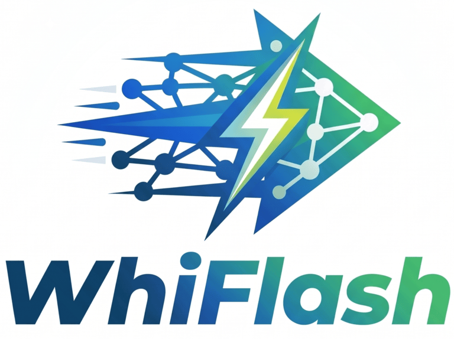
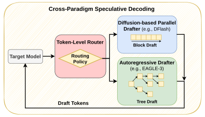
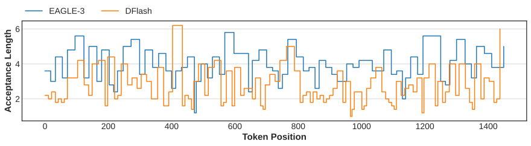

<h1 align="center">
  <picture>
    <source media="(prefers-color-scheme: dark)" srcset="docs/static/images/logo/whiflash_logo_dark.png">
    
  </picture>
  <br>
  Accelerating Speculative Decoding with Token-Level Cross-Paradigm Routing
</h1>

<p align="center">
<a href="assets/kwon2026whiflash.pdf"></a>
<a href="https://arxiv.org/abs/2606.07710"></a>
<a href="https://samsunglabs.github.io/WhiFlash/"></a>
<a href="./LICENSE"></a>
</p>

<p align="center">
<a href="https://huggingface.co/collections/WhiFlash/specvocab"></a>
<a href="https://huggingface.co/collections/WhiFlash/whiflash-neural"></a>
</p>

## 📰 News

- (🔥 New) **\[2026/10/16\]** 🎉 Initial code release of WhiFlash.
- (🔥 New) **\[2026/08/21\]** 🎉 The WhiFlash paper is accepted at EMNLP 2026.
- (🔥 New) **\[2026/06/05\]** 🎉 The WhiFlash paper is released on arXiv.

## 💡 Introduction

**WhiFlash** is the first **cross-paradigm** speculative decoding method: a lightweight **token-level router** that, at every decoding step, dynamically chooses between an **autoregressive drafter** ([EAGLE-3](https://github.com/SafeAILab/EAGLE)) and a **diffusion-based parallel drafter** ([DFlash](https://github.com/z-lab/dflash)). By capitalising on the complementary strengths of these fundamentally distinct drafting architectures, WhiFlash reaches higher acceptance lengths than either standalone drafter, yielding throughput gains of up to **69.6% over EAGLE-3** and **37.3% over DFlash**.

<div align="center">
  
</div>

## 🔬 Insight

State-of-the-art speculative decoding relies on *static* drafting paradigms: autoregressive (AR)
drafters excel at open-ended chat and reasoning, while diffusion-based parallel drafters dominate
highly structured outputs such as math and coding. We empirically find that the better paradigm changes **within a single sequence** — drafting accuracy fluctuates aggressively from token to token, and coarse-grained, task-level routing leaves unrealised speedups.

<div align="center">
  
</div>

WhiFlash addresses this volatility with a fine-grained controller that routes each decoding step to the highest-performing drafter at run time, using either a lightweight entropy-based or a learned neural router.

## 🔍 Method Overview

At each speculation round, the **target model** produces the next-token distribution and hidden states. A **token-level router** takes these features as inputs and selects which drafter to run next:

- **WhiFlash-Entropy**: A runtime-informed policy that routes based on the target's next-token entropy (low entropy: diffusion parallel drafter & high entropy: AR drafter). Calibrated on a small held-out set; no training required.
- **WhiFlash-Neural**: A lightweight 2-layer MLP that takes the target's final hidden state as inputs and predicts the expected acceptance length gain of switching drafters, enabling hardware-aware routing decisions by using different thresholds.

We develop two system optimisations to reduce the cost of switching between drafters, leading to the higher speedup:

- **Lazy Catch-up**: The inactive drafter's KV cache is updated in a lazy manner with a single batched prefill only when a switch is committed rather than being updated at every round.
- **KV-only Prefill**: This computes only the attention/KV for the backlog tokens, skipping the MLP and LM head.

Together, these keep the switching overhead **below 7% of per-round latency**.

## 📈 Results

WhiFlash-Neural's per-category **throughput gain** over each standalone drafter based on NVIDIA H100 GPU.

<table>
<tr><th rowspan="2">Category</th><th colspan="2"><div align="center">Qwen3-4B</div></th><th colspan="2"><div align="center">Qwen3-8B</div></th></tr>
<tr><th>vs. EAGLE-3</th><th>vs. DFlash</th><th>vs. EAGLE-3</th><th>vs. DFlash</th></tr>
<tr><td>Chat</td><td>+7.8%</td><td><b>+33.7%</b></td><td>+7.0%</td><td><b>+37.3%</b></td></tr>
<tr><td>Math</td><td><b>+69.6%</b></td><td>+4.8%</td><td><b>+69.3%</b></td><td>+1.3%</td></tr>
<tr><td>Coding</td><td><b>+63.4%</b></td><td>+6.5%</td><td><b>+61.0%</b></td><td>+5.2%</td></tr>
<tr><td>Agentic</td><td><b>+19.9%</b></td><td>+3.4%</td><td><b>+16.8%</b></td><td>+6.1%</td></tr>
</table>

Categories aggregate **Chat** (MT-Bench, Alpaca, UltraChat, WildChat), **Math** (GSM8K, MATH-500, AIME'24/'25), **Coding** (HumanEval, MBPP, LiveCodeBench) and **Agentic** (SWE-bench, τ-bench, AgentBench, AgentInstruct).

📄 Full results of acceptance length and speedup tables for all models are in the [paper](assets/kwon2026whiflash.pdf). Results vary by a few percent between runs and hardware, so expect re-runs with the release scripts to differ slightly.

### DDTree (post-paper)

[DDTree](https://github.com/liranringel/ddtree) was added after the paper. It is a stronger diffusion baseline than DFlash: same draft model, but candidates are verified as a tree rather than a linear block. **Speedup** over plain autoregressive decoding of every standalone drafter and of WhiFlash-Neural with each [drafter pair](#drafter-pair):

<table>
<tr><th>Model</th><th>Method</th><th>Chat</th><th>Math</th><th>Coding</th><th>Agentic</th><th>Avg.</th></tr>
<tr><td rowspan="7">Qwen3-4B</td><td>EAGLE-3</td><td>2.66×</td><td>2.97×</td><td>2.89×</td><td>2.13×</td><td>2.66×</td></tr>
<tr><td>DFlash</td><td>2.11×</td><td>5.04×</td><td>4.49×</td><td>2.31×</td><td>3.48×</td></tr>
<tr><td>DDTree (b32)</td><td>2.77×</td><td>5.70×</td><td>5.45×</td><td>2.95×</td><td>4.22×</td></tr>
<tr><td>DDTree (b128)</td><td>3.18×</td><td>6.42×</td><td>5.99×</td><td>3.25×</td><td>4.71×</td></tr>
<tr><td>WhiFlash-Neural (df-e3)</td><td>2.83×</td><td>5.11×</td><td>4.52×</td><td>2.45×</td><td>3.73×</td></tr>
<tr><td>WhiFlash-Neural (ddt-e3-b32)</td><td>3.03×</td><td>5.98×</td><td>5.58×</td><td>2.99×</td><td>4.40×</td></tr>
<tr><td>WhiFlash-Neural (ddt-e3-b128)</td><td><b>3.33×</b></td><td><b>6.59×</b></td><td><b>6.24×</b></td><td><b>3.26×</b></td><td><b>4.86×</b></td></tr>
<tr><td rowspan="7">Qwen3-8B</td><td>EAGLE-3</td><td>2.69×</td><td>3.09×</td><td>2.88×</td><td>2.38×</td><td>2.76×</td></tr>
<tr><td>DFlash</td><td>2.04×</td><td>5.14×</td><td>4.46×</td><td>2.60×</td><td>3.56×</td></tr>
<tr><td>DDTree (b32)</td><td>2.74×</td><td>5.75×</td><td>5.46×</td><td>3.36×</td><td>4.33×</td></tr>
<tr><td>DDTree (b128)</td><td>3.05×</td><td>6.56×</td><td><b>6.12×</b></td><td>3.58×</td><td>4.83×</td></tr>
<tr><td>WhiFlash-Neural (df-e3)</td><td>2.85×</td><td>5.04×</td><td>4.52×</td><td>2.73×</td><td>3.79×</td></tr>
<tr><td>WhiFlash-Neural (ddt-e3-b32)</td><td>3.06×</td><td>5.94×</td><td>5.47×</td><td>3.37×</td><td>4.46×</td></tr>
<tr><td>WhiFlash-Neural (ddt-e3-b128)</td><td><b>3.27×</b></td><td><b>6.62×</b></td><td>6.10×</td><td><b>3.71×</b></td><td><b>4.93×</b></td></tr>
</table>

> *Note: These results with DDTree are preliminary and come from a separate run; they are not comparable cell-to-cell with the paper's tables.*

## 🚀 Getting Started

### Installation

```bash
git clone https://github.com/SamsungLabs/WhiFlash.git
cd WhiFlash

uv sync
```

### Quick Start

WhiFlash needs a **target model**, a **DFlash draft** (diffusion drafter) and an **EAGLE-3 draft**
(autoregressive drafter). Every checkpoint below is fetched from the Hugging Face Hub on first use.

**1. WhiFlash-Neural, DFlash vs EAGLE-3**, the cross-paradigm pairing evaluated in the paper. The
learned router comes from the [released checkpoints](#released-checkpoints):

```bash
uv run benchmark.py \
    --speculative-algorithm WHIFLASH \
    --model-name-or-path Qwen/Qwen3-8B \
    --draft-name-or-path z-lab/Qwen3-8B-DFlash-b16 \
    --whiflash-eagle-draft WhiFlash/Qwen3-8B-EAGLE3 \
    --whiflash-router neural \
    --whiflash-neural-router-path WhiFlash/Qwen3-8B-NeuralRouter-df-e3 \
    --whiflash-neural-router-threshold 0.5 \
    --dataset mt-bench --max-samples 10 --max-new-tokens 2048
```

**2. WhiFlash-Neural, DDTree vs EAGLE-3**, the fastest configuration. Switch the drafter pair, and use
the router trained for that pair and tree budget:

```bash
uv run benchmark.py \
    --speculative-algorithm WHIFLASH \
    --model-name-or-path Qwen/Qwen3-8B \
    --draft-name-or-path z-lab/Qwen3-8B-DFlash-b16 \
    --whiflash-eagle-draft WhiFlash/Qwen3-8B-EAGLE3 \
    --whiflash-drafters ddt-e3 --ddtree-tree-budget 128 \
    --whiflash-router neural \
    --whiflash-neural-router-path WhiFlash/Qwen3-8B-NeuralRouter-ddt-e3-b128 \
    --whiflash-neural-router-threshold 1.0 \
    --dataset mt-bench --max-samples 10 --max-new-tokens 2048
```

**3. WhiFlash-Entropy** is training-free: it routes on the target's next-token entropy, so it needs no
router checkpoint. Use it for a target model that has no trained router:

```bash
uv run benchmark.py \
    --speculative-algorithm WHIFLASH \
    --model-name-or-path Qwen/Qwen3-8B \
    --draft-name-or-path z-lab/Qwen3-8B-DFlash-b16 \
    --whiflash-eagle-draft WhiFlash/Qwen3-8B-EAGLE3 \
    --whiflash-router entropy \
    --whiflash-entropy-threshold 0.2 \
    --dataset mt-bench --max-samples 10 --max-new-tokens 2048
```

> 💡 The thresholds above are examples for the Chat-category values for `Qwen/Qwen3-8B` on an NVIDIA H100. The best threshold depends on the hardware and the task category, so re-calibrate it for other setups ([`calibrate_thresholds.sh`](scripts/release/benchmark/calibrate_thresholds.sh)), and then run full benchmark experiments ([`benchmark.sh`](scripts/release/benchmark/benchmark.sh)).

**Routing policy** (`--whiflash-router`):

- `entropy` — WhiFlash-Entropy, with the threshold set by `--whiflash-entropy-threshold`.
- `neural` — WhiFlash-Neural. `--whiflash-neural-router-path` takes a Hub repo id, a local directory or an exported `.safetensors`; `--whiflash-neural-router-threshold` sets the threshold.

<a id="drafter-pair"></a>**Drafter pair** (`--whiflash-drafters`). The router is drafter-agnostic: it picks between two *slots*, and this flag decides which drafters fill them:

- `df-e3` *(default)* — DFlash vs EAGLE-3, the cross-paradigm pairing evaluated in the paper.
- `ddt-e3` — DDTree vs EAGLE-3.
- `df-ddt` — DFlash vs DDTree.

[DDTree](https://github.com/liranringel/ddtree) is a third drafter added after the paper. It reuses the DFlash draft model, but instead of verifying the drafted block as one linear sequence it builds a *tree* of candidates from the draft's per-position top-k logits and verifies it in a single target pass; `--ddtree-tree-budget` caps the number of tree nodes (default `block_size - 1`). It also runs standalone via `--speculative-algorithm DDTREE`.

> ⚠️ A neural router is trained for **one** drafter pair, so evaluate it with the `--whiflash-drafters` value (and DDTree budget) it was trained on. Lazy Catch-up is active by default (disable with `--whiflash-no-lazy-catchup`).

> 💡 Each command above is a single run. For the full benchmark experiments (every task category with the EAGLE-3, DFlash, DDTree, and WhiFlash methods), see [`benchmark.sh`](scripts/release/benchmark/benchmark.sh).

### Released Checkpoints

Our trained checkpoints are published on the Hugging Face Hub under
[**🤗 WhiFlash**](https://huggingface.co/WhiFlash).

**EAGLE-3 drafters** (`--whiflash-eagle-draft`, or `--draft-name-or-path` for standalone EAGLE-3):

| Target | EAGLE-3 draft |
|---|---|
| `Qwen/Qwen3-8B` | [`WhiFlash/Qwen3-8B-EAGLE3`](https://huggingface.co/WhiFlash/Qwen3-8B-EAGLE3) |
| `Qwen/Qwen3-4B` | [`WhiFlash/Qwen3-4B-EAGLE3`](https://huggingface.co/WhiFlash/Qwen3-4B-EAGLE3) |

**WhiFlash-Neural routers** (`--whiflash-neural-router-path`), one per drafter pair:

| Router | Target | `--whiflash-drafters` | `--ddtree-tree-budget` |
|---|---|---|---|
| [`WhiFlash/Qwen3-8B-NeuralRouter-df-e3`](https://huggingface.co/WhiFlash/Qwen3-8B-NeuralRouter-df-e3) | `Qwen/Qwen3-8B` | `df-e3` | — |
| [`WhiFlash/Qwen3-8B-NeuralRouter-ddt-e3-b32`](https://huggingface.co/WhiFlash/Qwen3-8B-NeuralRouter-ddt-e3-b32) | `Qwen/Qwen3-8B` | `ddt-e3` | `32` |
| [`WhiFlash/Qwen3-8B-NeuralRouter-ddt-e3-b128`](https://huggingface.co/WhiFlash/Qwen3-8B-NeuralRouter-ddt-e3-b128) | `Qwen/Qwen3-8B` | `ddt-e3` | `128` |
| [`WhiFlash/Qwen3-4B-NeuralRouter-df-e3`](https://huggingface.co/WhiFlash/Qwen3-4B-NeuralRouter-df-e3) | `Qwen/Qwen3-4B` | `df-e3` | — |
| [`WhiFlash/Qwen3-4B-NeuralRouter-ddt-e3-b32`](https://huggingface.co/WhiFlash/Qwen3-4B-NeuralRouter-ddt-e3-b32) | `Qwen/Qwen3-4B` | `ddt-e3` | `32` |
| [`WhiFlash/Qwen3-4B-NeuralRouter-ddt-e3-b128`](https://huggingface.co/WhiFlash/Qwen3-4B-NeuralRouter-ddt-e3-b128) | `Qwen/Qwen3-4B` | `ddt-e3` | `128` |

Router names spell out what each one was trained for: **`df`** = DFlash, **`ddt`** = DDTree, **`e3`** = EAGLE-3, and **`bN`** = DDTree tree budget `N`. The pair and budget map directly onto the flags, so `Qwen3-8B-NeuralRouter-ddt-e3-b32` routes between DDTree and EAGLE-3 for `Qwen/Qwen3-8B` and is run with `--whiflash-drafters ddt-e3 --ddtree-tree-budget 32`.

**Tested target models** (DFlash drafts come from the DFlash authors):

| Target | DFlash draft | EAGLE-3 draft |
|---|---|---|
| `Qwen/Qwen3-4B` | `z-lab/Qwen3-4B-DFlash-b16` | `WhiFlash/Qwen3-4B-EAGLE3` |
| `Qwen/Qwen3-8B` | `z-lab/Qwen3-8B-DFlash-b16` | `WhiFlash/Qwen3-8B-EAGLE3` |
| `meta-llama/Llama-3.1-8B-Instruct` | `z-lab/LLaMA3.1-8B-Instruct-DFlash-UltraChat` | `yuhuili/EAGLE3-LLaMA3.1-Instruct-8B` |

> ⚠️ **On EAGLE-3 drafters.** Publicly available EAGLE-3 drafters — especially for Qwen3 — are relatively weak, so a comparison against them overstates what cross-paradigm routing buys you. We therefore trained our own Qwen3 EAGLE-3 drafters with [SpecVocab](https://github.com/SamsungLabs/SpecVocab) and report WhiFlash's gains over that *strong* baseline; those are the checkpoints released above and used throughout our scripts. To train your own, use SpecVocab or [SpecForge](https://github.com/sgl-project/SpecForge), the standard EAGLE-3 training framework.

### Training the WhiFlash-Neural Router

`WhiFlash-Entropy` works out of the box, and our trained routers for `Qwen/Qwen3-8B` and `Qwen/Qwen3-4B` are listed under [Released Checkpoints](#released-checkpoints). To train `WhiFlash-Neural` for another target model or drafter pair, see [`neural_router/`](neural_router/) for the full data-generation and training workflow.

## 🗂️ Project Structure

```
WhiFlash/
├── model/            # The two component drafters (DFlash, EAGLE-3); DDTree reuses the DFlash draft
├── generation/       # Speculative decoding loops + WhiFlash token-level routers
├── neural_router/    # WhiFlash-Neural router (model + training)
├── data/             # Dataset loading & prompt formatting
├── data_files/       # Agentic benchmark data
├── configs/          # System prompts & latency profile for the utility-based oracle router
├── analysis/         # Profiling & paper-reproducibility tooling
├── scripts/          # Benchmark, router-training & profiling scripts
├── assets/           # Paper PDF
├── docs/             # Project page
├── LICENSES/         # Licenses of third-party code we build on
├── benchmark.py      # Transformers-backend benchmark (main entry point)
└── distributed.py    # Multi-GPU (torchrun) helpers for benchmark.py
```

The [`neural_router/`](neural_router/) directory has its own `README.md` with further details.

## 🙏 Acknowledgments

WhiFlash routes between two excellent standalone drafters and builds on their open-source code: the diffusion-based parallel drafter [DFlash](https://github.com/z-lab/dflash) (z-lab) and the autoregressive drafter [EAGLE-3](https://github.com/SafeAILab/EAGLE) (SafeAILab). We also build on [Hugging Face Transformers](https://github.com/huggingface/transformers), and train our EAGLE-3 drafters with [SpecVocab](https://github.com/SamsungLabs/SpecVocab), whose draft-model training pipeline extends [SpecForge](https://github.com/sgl-project/SpecForge). We thank the authors of these projects.

## 📝 Citation

If you find WhiFlash useful for your research or applications, please cite our paper:

```bibtex
@misc{kwon2026whiflash,
  title={{WhiFlash: Accelerating Speculative Decoding with Token-Level Cross-Paradigm Routing}},
  author={Young D. Kwon and Miles Williams and Rui Li and Alexandros Kouris and Stylianos I. Venieris},
  year={2026},
  eprint={2606.07710},
  archivePrefix={arXiv},
  primaryClass={cs.LG},
  url={https://arxiv.org/abs/2606.07710},
}
```

## 📄 Licenses

The license for our code and released checkpoints can be found in [LICENSE](LICENSE) (CC BY-NC-SA 4.0). All the licenses of the repositories whose code we use can be found [here](LICENSES).
